# SWS405 Digital Forensics — Assignment 2
## MemLabs Memory Forensics Challenge (Labs 1–5)

| | |
|---|---|
| **Name** | Dechen Wangdra Sherpa |
| **Student Number** | 02230281 |
| **Programme** | Software Engineering Programme, College of Science and Technology |
| **Module** | SWS405 – Digital Forensics |

---

## Table of Contents
1. [Introduction](#1-introduction)
2. [Lab Environment and Setup](#2-lab-environment-and-setup)
3. [Methodology](#3-methodology)
4. [Summary of Flags](#4-summary-of-flags)
5. [Lab 1 — Beginner's Luck](#5-lab-1--beginners-luck)
6. [Lab 2 — A New World](#6-lab-2--a-new-world)
7. [Lab 3 — The Evil's Den](#7-lab-3--the-evils-den)
8. [Lab 4 — Obsession](#8-lab-4--obsession)
9. [Lab 5 — Black Tuesday](#9-lab-5--black-tuesday)
10. [Conclusion](#10-conclusion)
11. [Appendix — Evidence Files](#11-appendix--evidence-files)

---

## 1. Introduction

Memory forensics is the analysis of a computer's RAM to find out what was happening on the system when the memory was captured. RAM holds evidence that often never reaches the disk: running processes, typed commands, open files, unsaved work, environment variables and even password hashes.

In this assignment I investigated five Windows memory images from **MemLabs** (github.com/stuxnet999/MemLabs) using **Volatility 2**. For each lab I followed the Part B investigation workflow, recorded the commands I ran (including dead ends), recovered the hidden flags, and explained the forensic principle behind each technique. Lab 6 (optional bonus) was not attempted.

---

## 2. Lab Environment and Setup

| Tool | Purpose |
|---|---|
| Kali Linux | Analysis workstation |
| Volatility 2.6 (Linux standalone binary) | Memory analysis framework |
| superponible/volatility-plugins | Community plugin pack (`chromehistory`) |
| unrar, 7z | Extracting RAR / ZIP archives |
| steghide, exiftool, binwalk, strings | Steganography and file inspection |
| GIMP | Viewing raw process memory as an image |
| KeePassXC | Opening the KeePass database |
| sqlite3 | Reading Chrome's History database |
| objdump, xxd, base64, sha1sum, python3 | Decoding, hashing and disassembly |

### Setup problems and how I solved them

The brief's Option A (`sudo apt install python volatility ...`) failed on my current Kali release:

```bash
sudo apt install -y python volatility ghex steghide unrar gimp git unzip
# Error: Package 'python' has no installation candidate
# Error: Unable to locate package volatility
```

Kali no longer ships Python 2 or the `volatility` package, so I used the official **Volatility 2.6 standalone Linux binary**, which has its own Python built in. I hit two more problems on the way:

1. **`Permission denied`** when downloading. My `memlabs` folder had been created as root, so I fixed the ownership with `sudo chown -R $USER:$USER ~/Desktop/SWS405`.
2. **`Cannot open self /usr/local/bin/volatility`**. The copied binary had permissions `rwx--x--x`, so my user could execute it but not read it. A standalone binary must read its own embedded files, so I fixed it with `sudo chmod 755 /usr/local/bin/volatility`.

```bash
wget http://downloads.volatilityfoundation.org/releases/2.6/volatility_2.6_lin64_standalone.zip
unzip volatility_2.6_lin64_standalone.zip
sudo cp volatility_2.6_lin64_standalone/volatility_2.6_lin64_standalone /usr/local/bin/volatility
sudo chmod 755 /usr/local/bin/volatility
volatility --info 2>&1 | head -20
git clone https://github.com/superponible/volatility-plugins.git ~/volatility-plugins
```

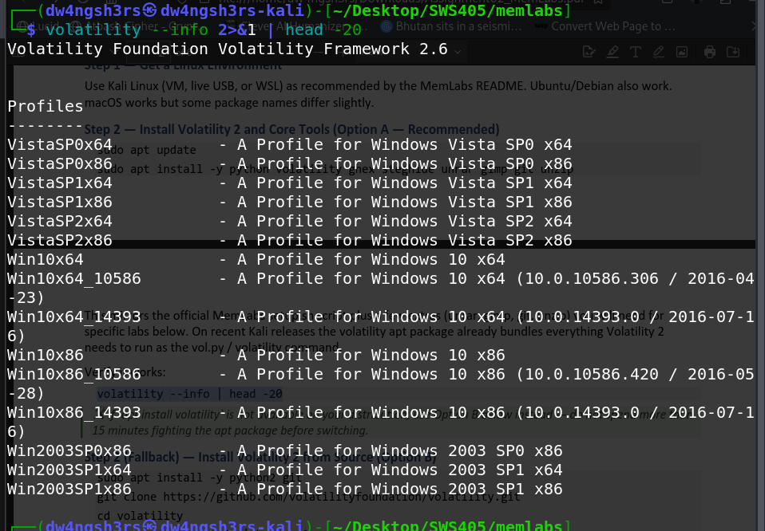

*Figure 0.1 – Volatility 2.6 standalone binary running and listing its Windows profiles.*

---

## 3. Methodology

For every lab I used the same approach:

1. **Verify evidence integrity.** I compared the MD5 hash of each memory image with the hash in the lab README before analysing it. A matching hash proves my copy of the evidence is unchanged.
2. **Identify the profile** with `imageinfo`.
3. **Follow the Part B checklist:** scope processes → command-line activity → environment variables → files in memory → credentials → deleted data → browser artifacts → correlate.
4. **Record everything.** I ran `script -a labX_terminal_log.txt` at the start of each lab so every command and its output (including failures) was saved.
5. **Rename extracted files.** Files dumped from memory were renamed to their original names and kept in that lab's folder.

---

## 4. Summary of Flags

| Lab | Flag(s) |
|---|---|
| 1 | `flag{th1s_1s_th3_1st_st4g3!!}` `flag{G00d_BoY_good_girL}` `flag{w3ll_3rd_stage_was_easy}` |
| 2 | `flag{w3lc0m3_T0_$T4g3_!_Of_L4B_2}` `flag{w0w_th1s_1s_Th3_SeC0nD_ST4g3_!!}` `flag{oK_So_Now_St4g3_3_is_DoNE!!}` |
| 3 | `inctf{0n3_h4lf_1s_n0t_3n0ugh}` |
| 4 | `inctf{1_is_n0t_EQu4l_7o_2_bUt_th1s_d0s3nt_m4ke_s3ns3}` |
| 5 | `flag{!!_w3LL_d0n3_St4g3-1_0f_L4B_5_D0n3_!!}` `flag{W1th_th1s_$taGe_2_1s_cOmPL3T3_!!}` `bi0s{M3m_l4B5_OVeR_!}` |

---

## 5. Lab 1 — Beginner's Luck

**Scenario:** A sister's computer crashed. A black window popped up with something being executed, and she was trying to draw something at the time of the crash. The lab has three flags.

### 5.1 Investigation Log

**Step 1 — Verify and identify the image**
```bash
md5sum MemoryDump_Lab1.raw
volatility -f MemoryDump_Lab1.raw imageinfo
```
The hash matched the README, and the suggested profile was `Win7SP1x64`.

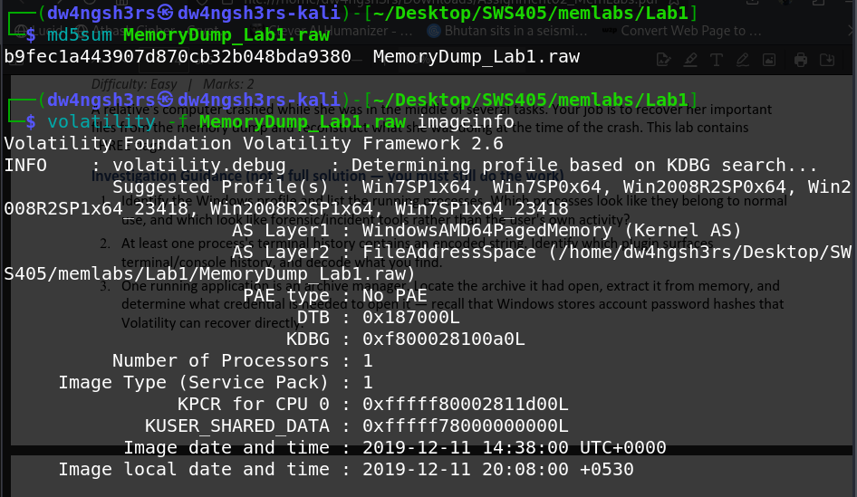

*Figure 1.1 – MD5 hash matches the README; imageinfo suggests Win7SP1x64.*

**Step 2 — Scope the processes**
```bash
volatility -f MemoryDump_Lab1.raw --profile=Win7SP1x64 pstree
```
Processes linked to the story:

| Process | PID | Meaning |
|---|---|---|
| `cmd.exe` | 1984 | The "black window" |
| `mspaint.exe` | 2424 | "Trying to draw something" |
| `WinRAR.exe` | 1512 | Archive manager, so an archive was open |
| `DumpIt.exe` | 796 | **Not user activity.** This is the memory acquisition tool used to capture the dump. |

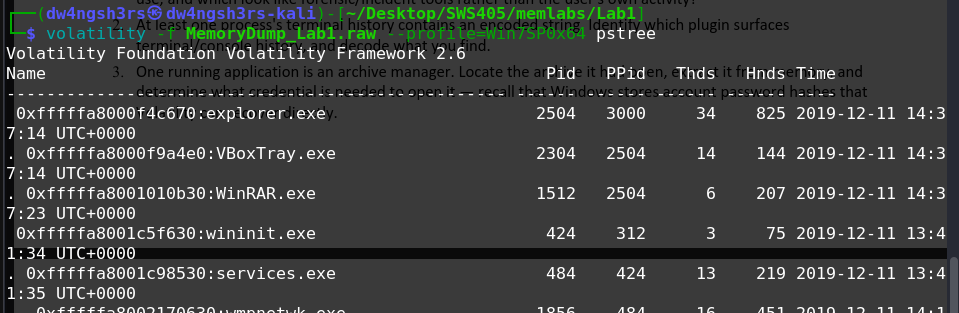

*Figure 1.2 – pstree (part 1) showing explorer.exe and WinRAR.exe (PID 1512).*

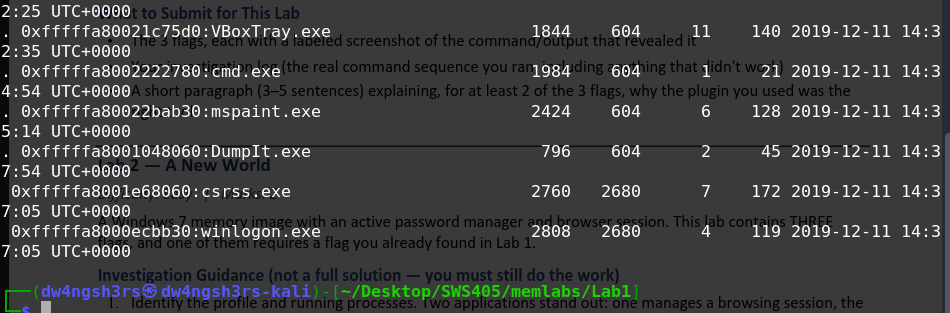

*Figure 1.3 – pstree (part 2) showing cmd.exe (1984), mspaint.exe (2424) and DumpIt.exe (796).*

**Step 3 — Command-line activity (Flag 1)**
```bash
volatility -f MemoryDump_Lab1.raw --profile=Win7SP1x64 cmdscan
volatility -f MemoryDump_Lab1.raw --profile=Win7SP1x64 consoles
```
`cmdscan` showed only the command that was typed: `St4G3$1`. It did not show what the command printed. `consoles` also shows the console **screen buffer**, and there the program's output was visible: a Base64-looking string, `ZmxhZ3t0aDFzXzFzX3RoM18xc3Rfc3Q0ZzMhIX0=`. The second console belonged to DumpIt and showed the memory dump being written to `SMARTNET-PC-20191211-143755.raw`, which confirms DumpIt was the acquisition tool.

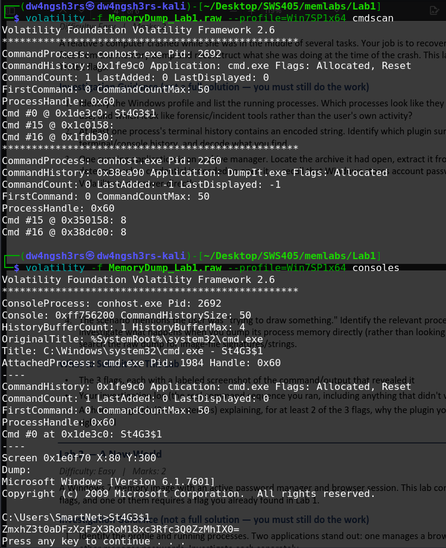

*Figure 1.4 – cmdscan shows only the command `St4G3$1`; consoles shows its output, an encoded string.*

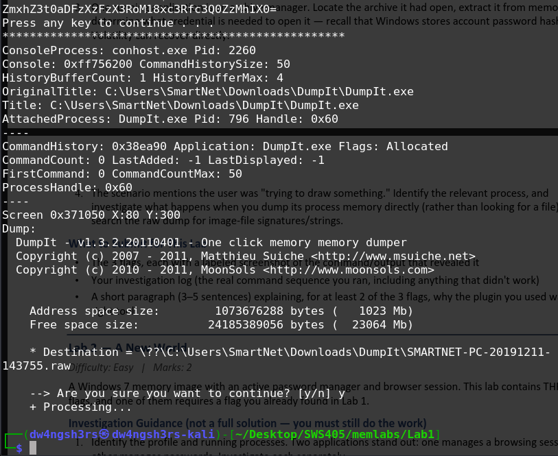

*Figure 1.5 – Second console (DumpIt.exe) confirming the memory acquisition.*

```bash
echo "ZmxhZ3t0aDFzXzFzX3RoM18xc3Rfc3Q0ZzMhIX0=" | base64 -d; echo
```

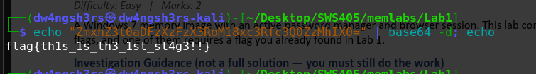

*Figure 1.6 – **Flag 1:** `flag{th1s_1s_th3_1st_st4g3!!}` decoded from Base64.*

**Step 4 — The unsaved drawing (Flag 2)**

The drawing was never saved, so it only existed as pixels inside mspaint's memory. I dumped the whole process and opened it as raw image data in GIMP.
```bash
volatility -f MemoryDump_Lab1.raw --profile=Win7SP1x64 memdump -p 2424 -D .
mv 2424.dmp 2424.data
gimp 2424.data
```

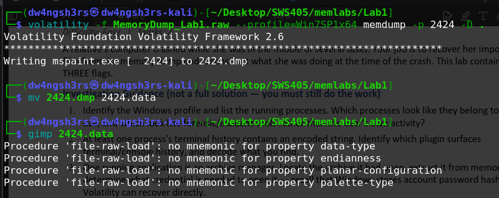

*Figure 1.7 – mspaint.exe (PID 2424) process memory written to 2424.dmp and renamed to .data for GIMP.*

*Dead end:* my first attempt used Width 350 × Height 350, which showed only noise (Figure 1.8). After trying different values, **RGB 8-bit, Width 3280, Height 1000** produced readable handwriting (Figure 1.9). The text appeared upside down, so I flipped the image vertically to read it (Figure 1.10).

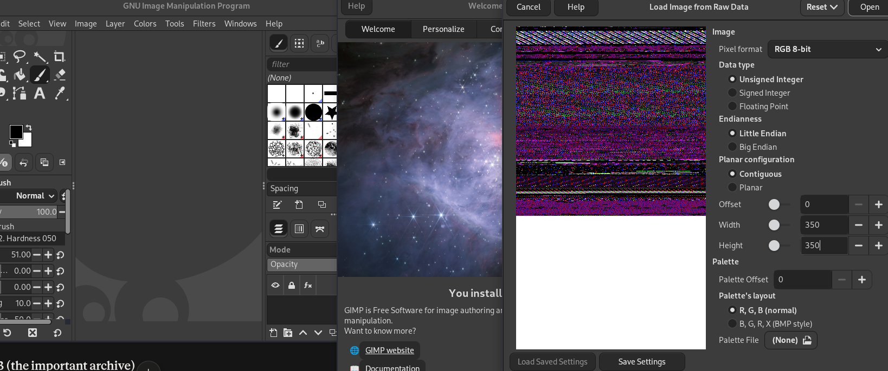

*Figure 1.8 – First GIMP attempt (350 × 350): only noise, a documented dead end.*

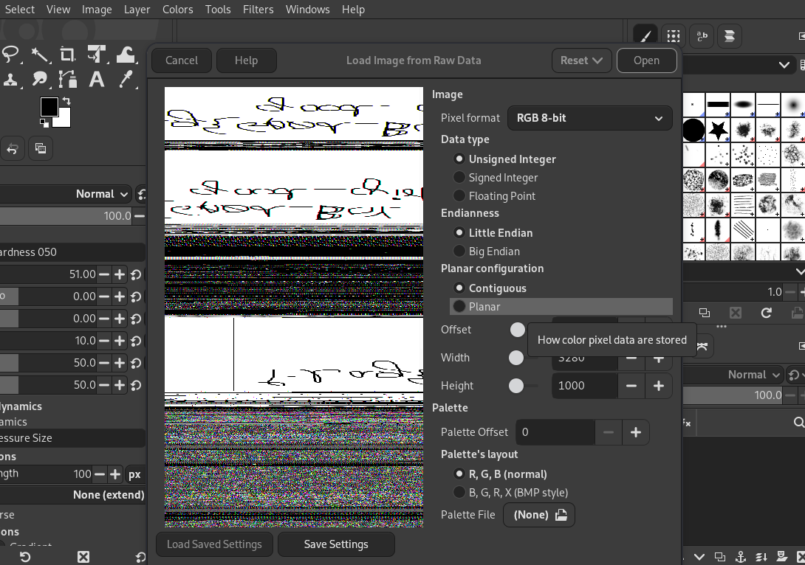

*Figure 1.9 – Working settings (RGB 8-bit, Width 3280, Height 1000): handwriting appears in the preview.*

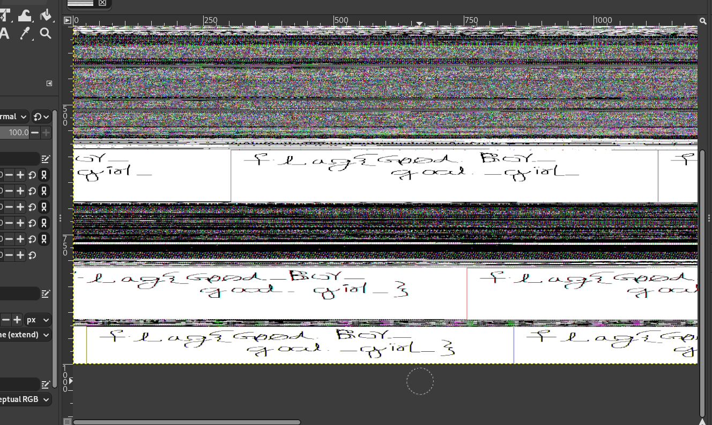

*Figure 1.10 – **Flag 2:** `flag{G00d_BoY_good_girL}` recovered from the unsaved MS Paint canvas.*

**Step 5 — The important archive (Flag 3)**
```bash
volatility -f MemoryDump_Lab1.raw --profile=Win7SP1x64 cmdline -p 1512
```
WinRAR had opened `C:\Users\Alissa Simpson\Documents\Important.rar`.

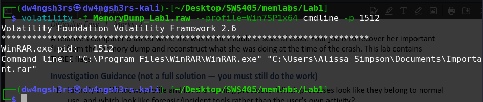

*Figure 1.11 – WinRAR.exe command line pointing to Important.rar.*

```bash
volatility -f MemoryDump_Lab1.raw --profile=Win7SP1x64 filescan > lab1_filescan.txt
grep -i "important" lab1_filescan.txt
volatility -f MemoryDump_Lab1.raw --profile=Win7SP1x64 dumpfiles -Q 0x000000003fa3ebc0 -D .
ls -l file.None.*
mv file.None.0xfffffa8001034450.dat Important.rar
```
Three file objects for Important.rar were found. I dumped the first offset, which produced a 45,056-byte file.

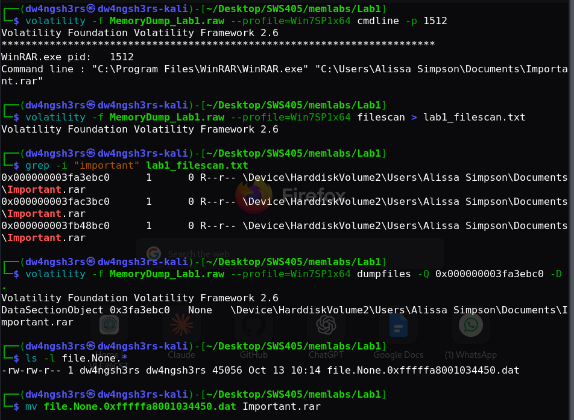

*Figure 1.12 – Locating Important.rar with filescan and extracting it with dumpfiles.*

```bash
unrar l Important.rar
```
The archive comment said: *"Password is NTLM hash (in uppercase) of Alissa's account passwd."* The archive contained `flag3.png`.

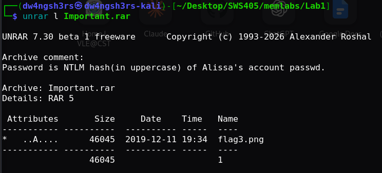

*Figure 1.13 – Archive comment explaining how to derive the password.*

```bash
volatility -f MemoryDump_Lab1.raw --profile=Win7SP1x64 hashdump
```
Alissa Simpson (RID 1003) had NTLM hash `f4ff64c8baac57d22f22edc681055ba6`. Hashdump lines use the format `user:RID:LM:NTLM:::`, so the NTLM hash is the fourth field.

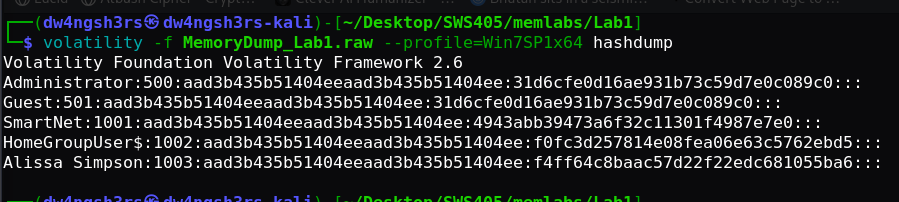

*Figure 1.14 – hashdump recovering account hashes; Alissa Simpson's NTLM hash is the last field.*

```bash
echo "f4ff64c8baac57d22f22edc681055ba6" | tr 'a-f' 'A-F'
unrar x Important.rar    # password: F4FF64C8BAAC57D22F22EDC681055BA6
```

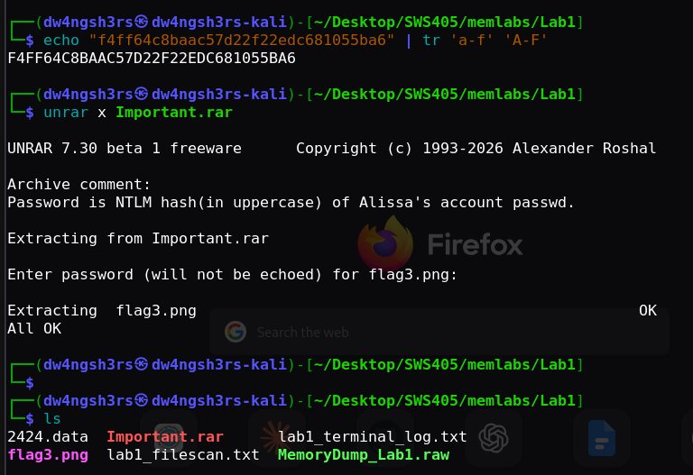

*Figure 1.15 – Hash converted to uppercase and used to extract flag3.png ("All OK").*

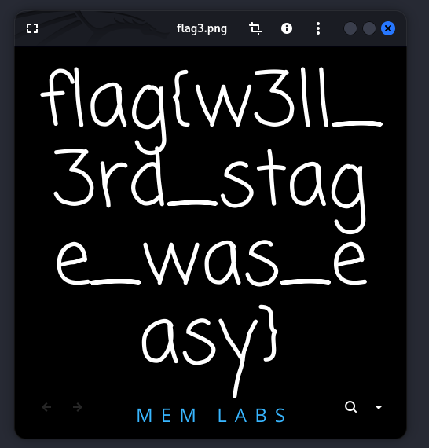

*Figure 1.16 – **Flag 3:** `flag{w3ll_3rd_stage_was_easy}`.*

### 5.2 Flags

| # | Flag | Evidence |
|---|---|---|
| 1 | `flag{th1s_1s_th3_1st_st4g3!!}` | Figures 1.4, 1.6 |
| 2 | `flag{G00d_BoY_good_girL}` | Figures 1.7, 1.10 |
| 3 | `flag{w3ll_3rd_stage_was_easy}` | Figures 1.13–1.16 |

### 5.3 Forensic Reasoning

`consoles` was the right tool for Flag 1 because it reads the console host's **screen buffer**, which holds what a program printed; `cmdscan` only reads the command history, so it showed the command name but not the encoded output. For Flag 2, the drawing was never saved, so no file existed on disk or in the file cache; `memdump` writes out everything the mspaint process had in memory, which still included the raw canvas pixels. For Flag 3, `hashdump` was the right tool because Windows keeps the SAM and SYSTEM registry hives in memory, so the account's NTLM hash could be recovered without the disk or the password. Together these show the core principle of memory forensics: RAM holds **volatile evidence** (screen output, unsaved work, credentials) that disappears when the machine powers off.

---

## 6. Lab 2 — A New World

**Scenario:** A client who is a popular "environmental" activist lost access to his system. His go-to applications are browsers and password managers. The lab has three flags, and one of them needs a flag from Lab 1.

### 6.1 Investigation Log

**Step 1 — Verify and identify the image**
```bash
md5sum MemoryDump_Lab2.raw
volatility -f MemoryDump_Lab2.raw imageinfo
```

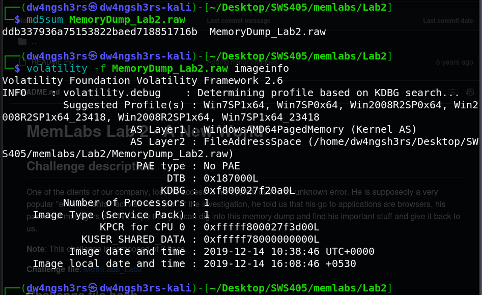

*Figure 2.1 – MD5 hash matches the README; profile Win7SP1x64.*

**Step 2 — Scope the processes**
```bash
volatility -f MemoryDump_Lab2.raw --profile=Win7SP1x64 pstree
```
The two applications that stood out were `chrome.exe` (PID 2296 plus child processes, the browsing session) and `KeePass.exe` (PID 3008, the password manager). I also noted `notepad.exe` (3260), `cmd.exe` (2096), and `DumpIt.exe` (3844), which was the acquisition tool.

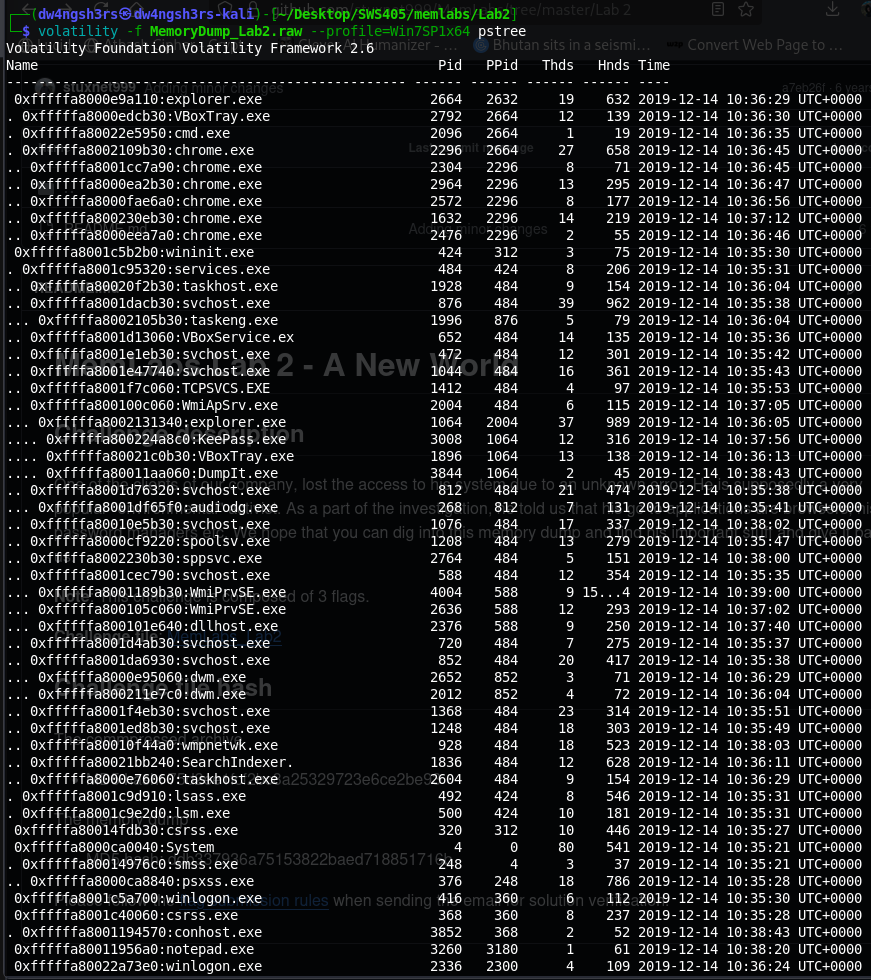

*Figure 2.2 – pstree showing chrome.exe, KeePass.exe, notepad.exe and DumpIt.exe.*

**Step 3 — Environment variables (Flag 1)**

The word "environmental" in the story pointed to environment variables. `envars` produced 1,704 lines, so instead of scrolling I searched for long Base64-looking values, which Windows does not normally store in environment variables.
```bash
volatility -f MemoryDump_Lab2.raw --profile=Win7SP1x64 envars > lab2_envars.txt
wc -l lab2_envars.txt
grep -E "[A-Za-z0-9+/]{30,}={0,2}" lab2_envars.txt
```
A custom variable, `NEW_TMP`, held the value `C:\Windows\ZmxhZ3t3M2xjMG0zX1QwXyRUNGczXyFfT2ZfTDRCXzJ9` in many processes (csrss, winlogon, services, lsass, …). It appears in so many processes because child processes inherit their parent's environment.

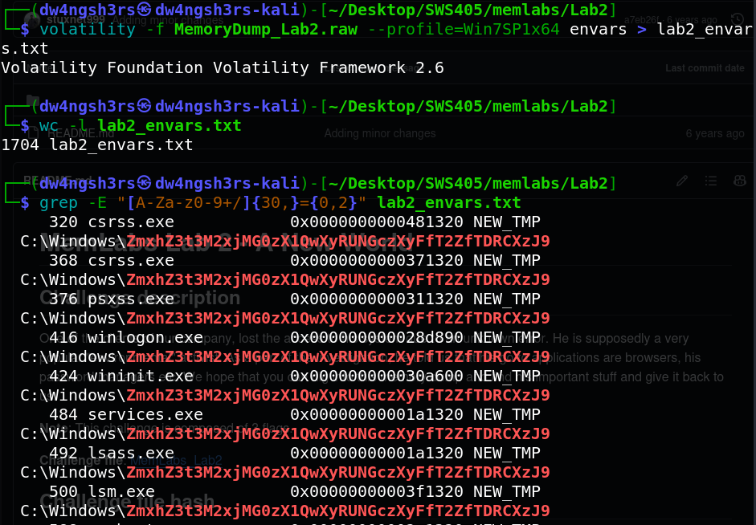

*Figure 2.3 – Regex search finds the unusual NEW_TMP variable with an encoded path.*

```bash
echo 'ZmxhZ3t3M2xjMG0zX1QwXyRUNGczXyFfT2ZfTDRCXzJ9' | base64 -d; echo
```

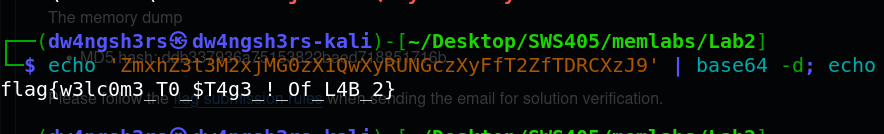

*Figure 2.4 – **Flag 1:** `flag{w3lc0m3_T0_$T4g3_!_Of_L4B_2}`.*

**Step 4 — The KeePass database (Flag 2)**
```bash
volatility -f MemoryDump_Lab2.raw --profile=Win7SP1x64 cmdline -p 3008,3260
```
Both KeePass and Notepad had opened the same file: `C:\Users\SmartNet\Secrets\Hidden.kdbx`.

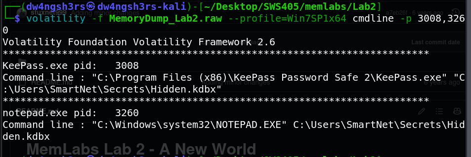

*Figure 2.5 – KeePass.exe and notepad.exe both opened Hidden.kdbx.*

```bash
volatility -f MemoryDump_Lab2.raw --profile=Win7SP1x64 filescan > lab2_filescan.txt
grep -i "kdbx" lab2_filescan.txt
volatility -f MemoryDump_Lab2.raw --profile=Win7SP1x64 dumpfiles -Q 0x000000003fb112a0 -D .
mv file.None.0xfffffa8001593ba0.dat Hidden.kdbx
file Hidden.kdbx
```

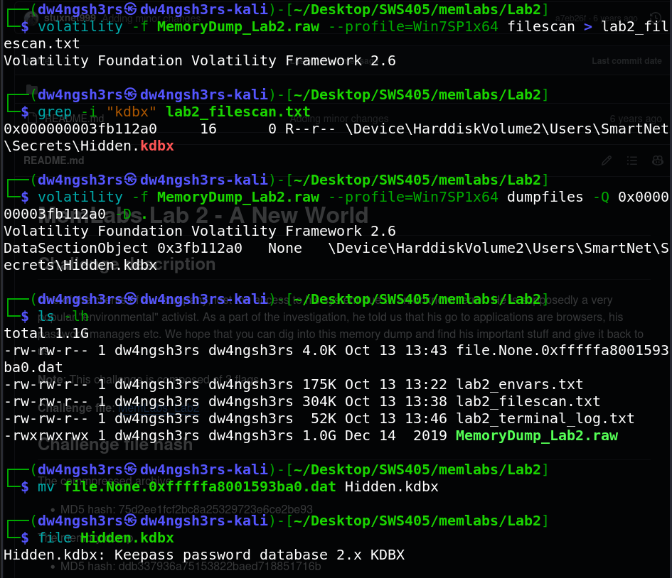

*Figure 2.6 – Hidden.kdbx extracted; `file` confirms "Keepass password database 2.x KDBX".*

The database needs a master password, and it was not stored next to the database in plain text. I searched the file list for anything password-related. Most hits were KeePass program files, but one was a user image: `\Users\Alissa Simpson\Pictures\Password.png`.
```bash
grep -i "password" lab2_filescan.txt
volatility -f MemoryDump_Lab2.raw --profile=Win7SP1x64 dumpfiles -Q 0x000000003fce1c70 -D .
mv file.None.0xfffffa8000d06e10.dat Password.png
```

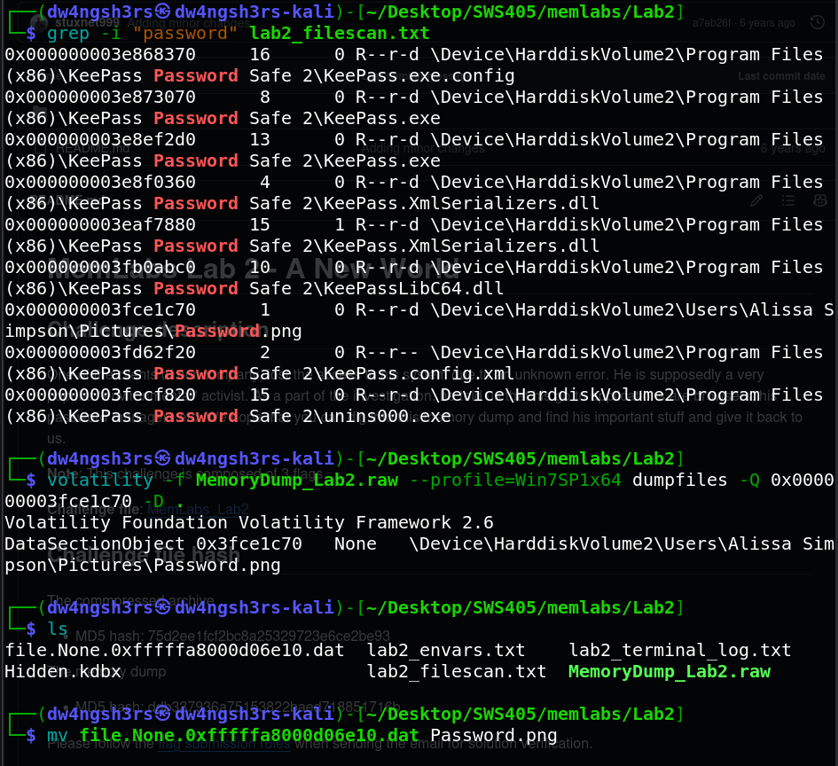

*Figure 2.7 – Password.png located in the file list and extracted.*

The image said "the flag is not here", but small text in the bottom-right corner gave the master password: **`P4SSw0rd_123`**.


*Figure 2.8 – Password.png with the master password hidden in the bottom-right corner.*

```bash
keepassxc Hidden.kdbx
```
I opened the database with the recovered password. The flag was in the **Recycle Bin** group, which holds deleted entries, under an entry titled "Sabka Baap" with username "Flag".

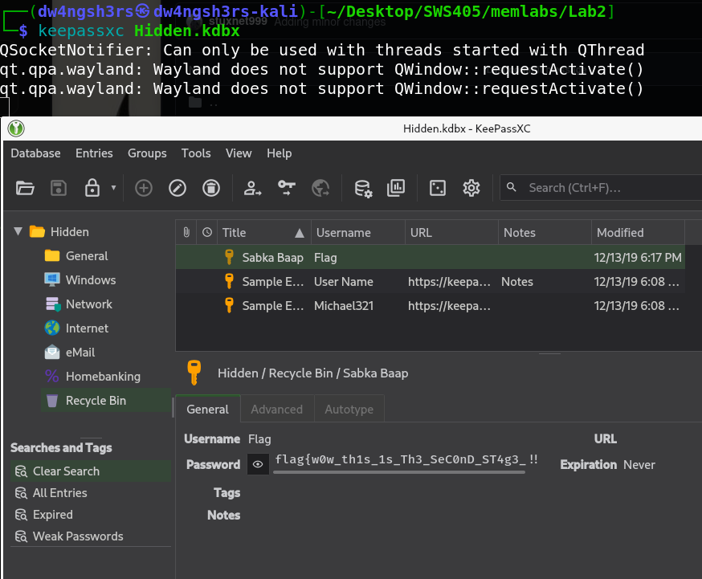

*Figure 2.9 – **Flag 2:** `flag{w0w_th1s_1s_Th3_SeC0nD_ST4g3_!!}` in the KeePass Recycle Bin.*

**Step 5 — Chrome browsing history (Flag 3)**

*Dead end:* the community `chromehistory` plugin would not run.
```bash
volatility --plugins=$HOME/volatility-plugins -f MemoryDump_Lab2.raw --profile=Win7SP1x64 chromehistory > lab2_chromehistory.txt
# ERROR: You must specify something to do (try -h)
volatility --plugins=$HOME/volatility-plugins --info 2>&1 | grep -i chrome
# *** Failed to import volatility.plugins.chromehistory (ImportError: No module named csv)
```
The standalone Volatility binary has its own built-in Python, which does not include the `csv` module, so the plugin failed to import.

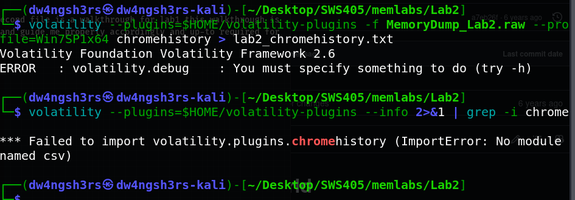

*Figure 2.10 – chromehistory plugin failed to load (missing `csv` module), a documented dead end.*

*Workaround:* Chrome keeps its history in an SQLite database called `History`, which is the same data the plugin reads. I extracted that file from memory and queried it directly.
```bash
grep -i "Chrome.*History" lab2_filescan.txt
volatility -f MemoryDump_Lab2.raw --profile=Win7SP1x64 dumpfiles -Q 0x000000003fcfb1d0 -D .
ls -l file.None.*
mv file.None.0xfffffa8000efd1d0.dat History
file History
sqlite3 History "SELECT id, url, title FROM urls;"
```

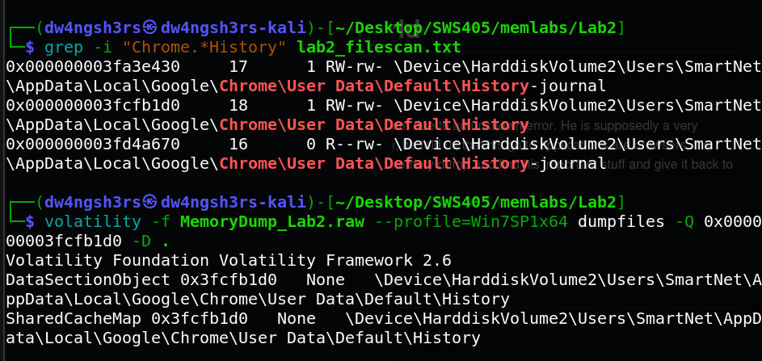

*Figure 2.11 – Chrome's `Default\History` file located and extracted from memory.*

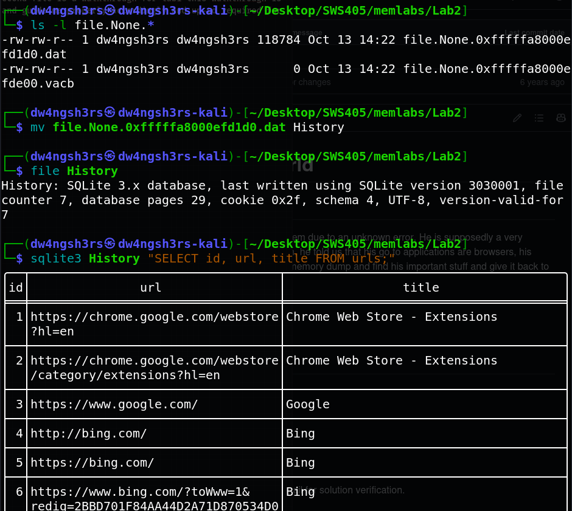

*Figure 2.12 – `file` confirms an SQLite 3.x database; querying the urls table.*

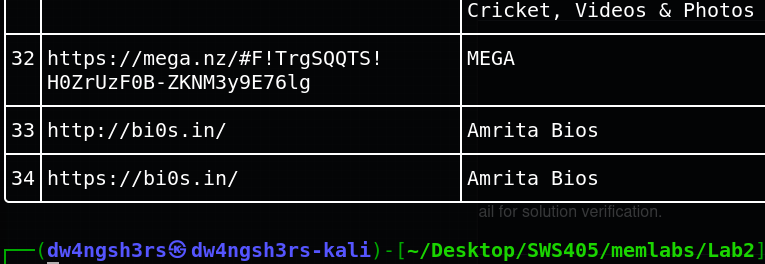

*Figure 2.13 – Entry 32: a link to the MEGA file-sharing service (`https://mega.nz/#F!TrgSQQTS!H0ZrUzF0B-ZKNM3y9E76lg`).*

I opened the link in my browser. It was a folder called `MemLabs_Lab2_Stage3` containing `Important.zip`, which I downloaded.

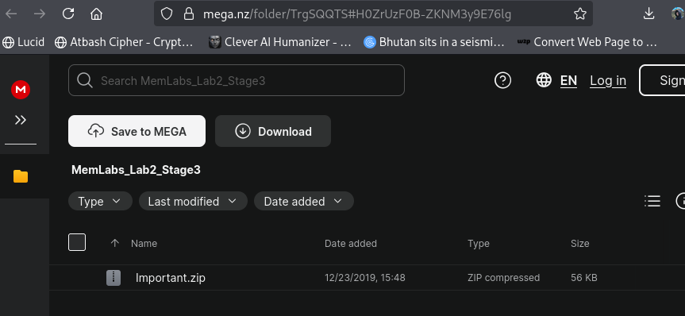

*Figure 2.14 – MEGA folder containing Important.zip.*

```bash
unzip -z Important.zip
echo -n 'flag{w3ll_3rd_stage_was_easy}' | sha1sum
7z x Important.zip    # password: 6045dd90029719a039fd2d2ebcca718439dd100a
```
An earlier extraction attempt had left an empty (0-byte) `Important.png`. 7z replaced it with the real 59,291-byte file ("Everything is Ok").

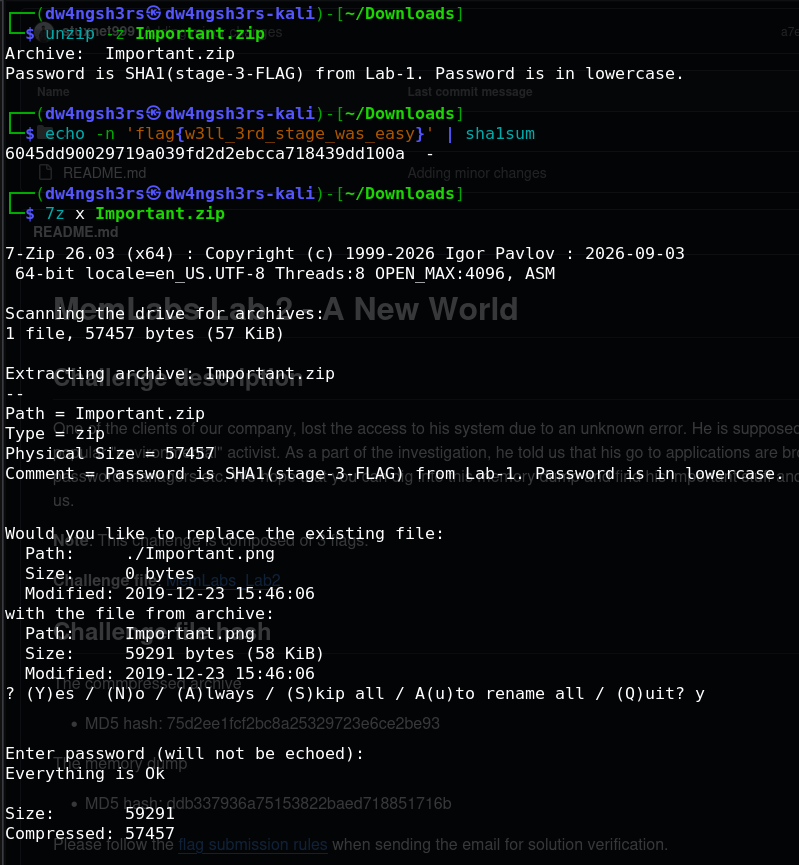

*Figure 2.15 – Zip comment, SHA1 of the Lab 1 stage-3 flag, and successful 7z extraction.*

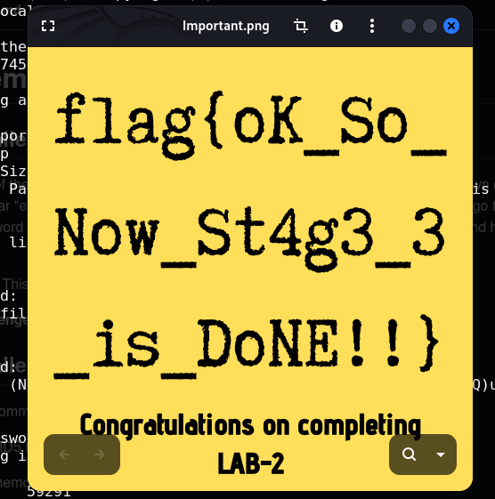

*Figure 2.16 – **Flag 3:** `flag{oK_So_Now_St4g3_3_is_DoNE!!}`.*

### 6.2 Flags

| # | Flag | Evidence |
|---|---|---|
| 1 | `flag{w3lc0m3_T0_$T4g3_!_Of_L4B_2}` | Figures 2.3, 2.4 |
| 2 | `flag{w0w_th1s_1s_Th3_SeC0nD_ST4g3_!!}` | Figures 2.6–2.9 |
| 3 | `flag{oK_So_Now_St4g3_3_is_DoNE!!}` | Figures 2.13–2.16 |

### 6.3 Deriving the Final Archive Password

The comment inside `Important.zip` said: *"Password is SHA1(stage-3-FLAG) from Lab-1. Password is in lowercase."* The Lab 1 stage-3 flag is `flag{w3ll_3rd_stage_was_easy}`. I hashed it with **SHA-1** using `echo -n '...' | sha1sum`. The `-n` option matters: without it, `echo` adds a newline character and the hash would be completely different. `sha1sum` already prints **lowercase** hexadecimal, so no case conversion was needed. The password was `6045dd90029719a039fd2d2ebcca718439dd100a`, and it opened the archive with 7z.

### 6.4 Forensic Reasoning

`envars` worked for Flag 1 because each process keeps its own copy of its environment block in memory, so a custom variable set on the system is visible across many processes. For Flag 2, `cmdline` linked the running applications to the evidence file, and `filescan` + `dumpfiles` recovered both the database and the image holding its key from the file cache. The flag sat in KeePass's Recycle Bin, which shows that "deleted" data inside an application can still be recovered. For Flag 3, browser history connected the local machine to an external file-sharing service, which is a good example of **correlating evidence across sources**: memory → history → online file → a flag from a previous case.

---

## 7. Lab 3 — The Evil's Den

**Scenario:** A malicious script encrypted a secret piece of information. There is one flag, split into two halves, and the first half is needed to get the second (Note-2). Flag format: `inctf{...}`.

### 7.1 Investigation Log

**Step 1 — Verify and identify the image**
```bash
md5sum MemoryDump_Lab3.raw
volatility -f MemoryDump_Lab3.raw imageinfo
```
This image is **32-bit**, so I used `Win7SP1x86_23418` instead of the x64 profile.

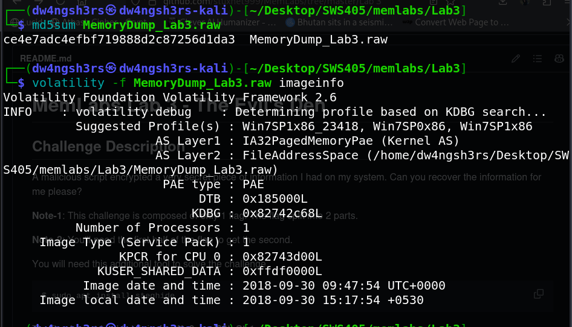

*Figure 3.1 – MD5 matches; imageinfo suggests Win7SP1x86_23418 (32-bit, PAE).*

**Step 2 — Scope the processes**
```bash
volatility -f MemoryDump_Lab3.raw --profile=Win7SP1x86_23418 pstree
```
Two `notepad.exe` processes (PIDs 3736 and 3432) were running under explorer.exe, along with `DumpIt.exe` (4116), the acquisition tool.

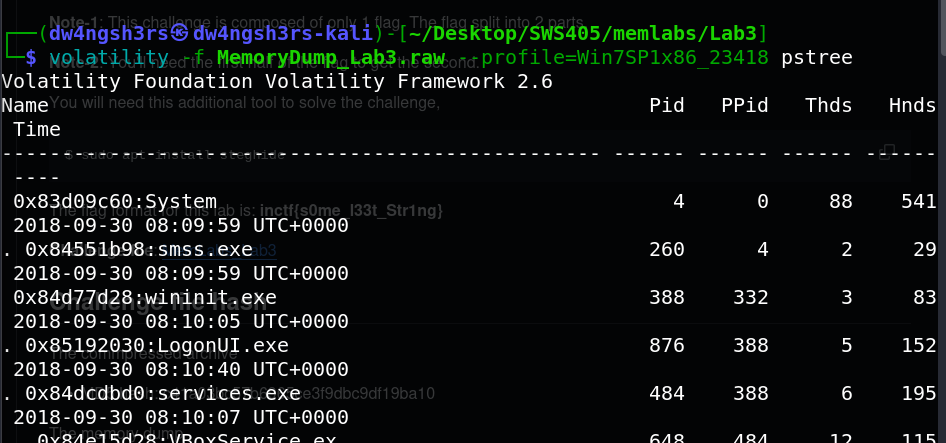

*Figure 3.2 – pstree (part 1).*

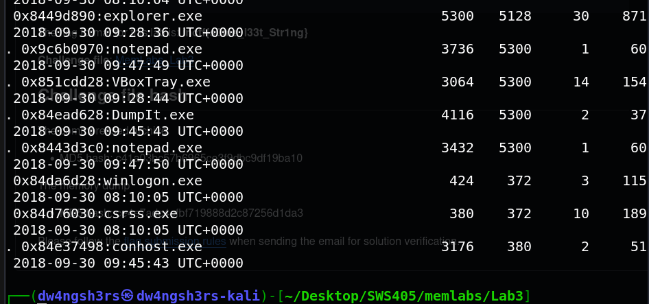

*Figure 3.3 – pstree (part 2) showing the two notepad.exe processes and DumpIt.exe.*

**Step 3 — What was being edited**
```bash
volatility -f MemoryDump_Lab3.raw --profile=Win7SP1x86_23418 cmdline -p 3736,3432
```
Notepad 3736 had `C:\Users\hello\Desktop\evilscript.py` open (the script), and Notepad 3432 had `C:\Users\hello\Desktop\vip.txt` open (its output).

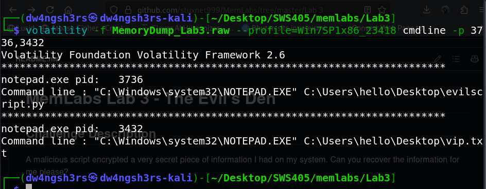

*Figure 3.4 – The two Notepad processes opened evilscript.py and vip.txt.*

**Step 4 — Extract both files**
```bash
volatility -f MemoryDump_Lab3.raw --profile=Win7SP1x86_23418 filescan > lab3_filescan.txt
grep -i "evilscript" lab3_filescan.txt
grep -i "vip" lab3_filescan.txt
volatility -f MemoryDump_Lab3.raw --profile=Win7SP1x86_23418 dumpfiles -Q 0x000000003de1b5f0 -D .
volatility -f MemoryDump_Lab3.raw --profile=Win7SP1x86_23418 dumpfiles -Q 0x000000003e727e50 -D .
mv file.None.0xbc2b6af0.dat evilscript.py
mv file.None.0x83e52420.dat vip.txt
```
I chose the Desktop copies, not the `.lnk` shortcuts in the `Recent` folder. On disk the script was actually named `evilscript.py.py`.

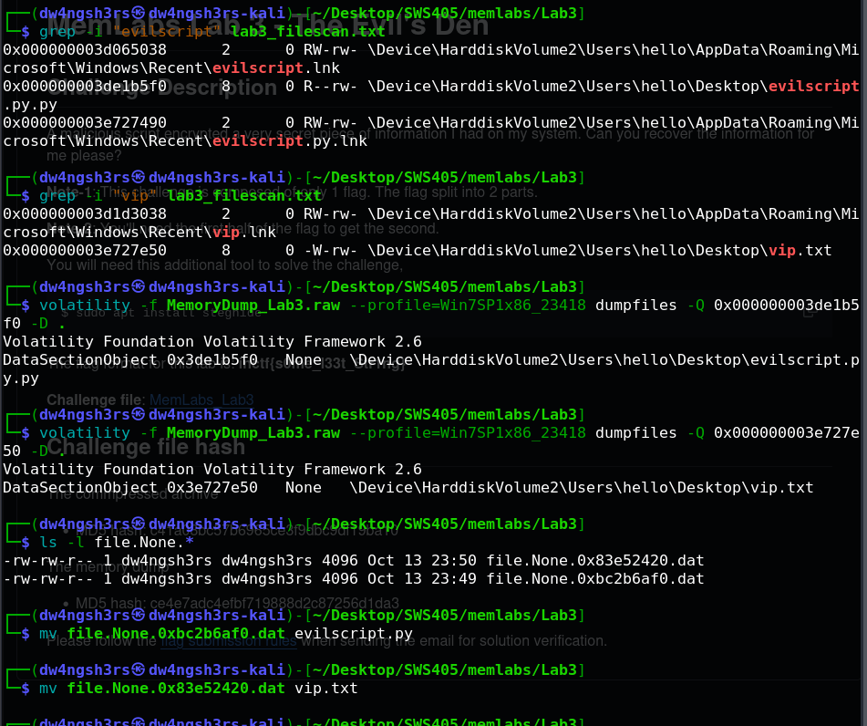

*Figure 3.5 – Locating and extracting evilscript.py and vip.txt.*

**Step 5 — Read the script and reverse it (first half)**
```bash
cat evilscript.py
```

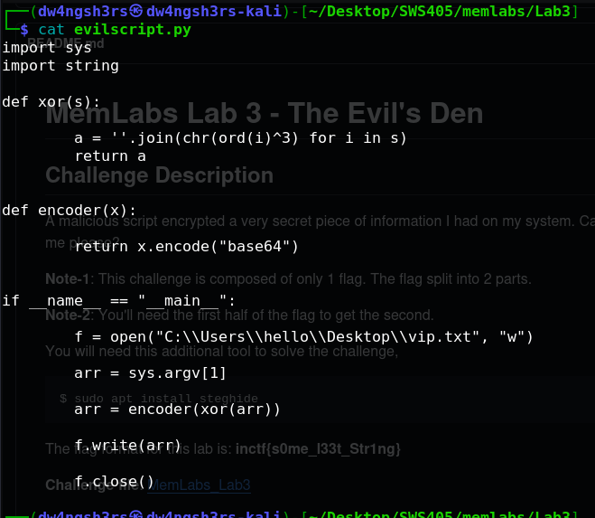

*Figure 3.6 – Source of the malicious script.*

The script takes the secret text as a command-line argument (`sys.argv[1]`), **XORs every character with the key 3**, then **Base64-encodes** the result, and writes it to `vip.txt`. The content of `vip.txt` was `am1gd2V4M20wXGs3b2U=`.

To reverse it, I undid the steps in the opposite order: first Base64-decode, then XOR each byte with 3 again. XOR is its own inverse, so applying the same key a second time restores the original. I wrote my own reversing script:

```python
# reverse.py
import base64

data = open("vip.txt").read().strip().strip("\x00")
step1 = base64.b64decode(data)            # undo the LAST step first
key = 3                                    # key read from evilscript.py
print("".join(chr(b ^ key) for b in step1))
```
```bash
cat vip.txt; echo
python3 reverse.py
```

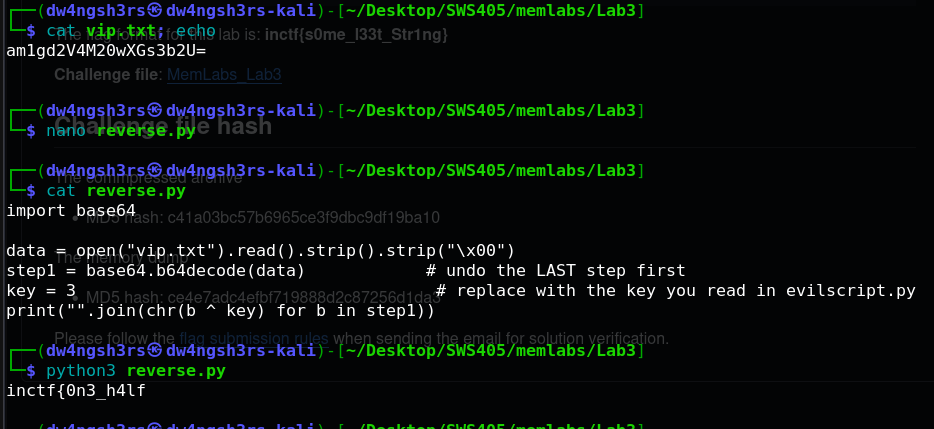

*Figure 3.7 – Ciphertext, my reversing script, and the first half: `inctf{0n3_h4lf`.*

**Step 6 — Find the stego image (second half)**

steghide supports JPEG, BMP, WAV and AU files, so I searched for those extensions.
```bash
grep -Ei "\.(jpg|jpeg|bmp|wav|au)$" lab3_filescan.txt
```
Almost every hit was a browser cache image with a random name inside `Temporary Internet Files`. One file was out of place: `\Users\hello\Desktop\suspision1.jpeg`, which was on the Desktop and had a suspicious name.

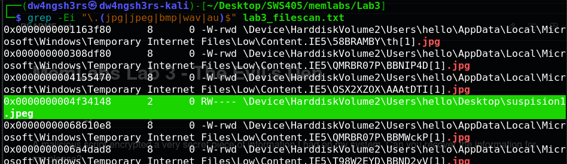

*Figure 3.8 – suspision1.jpeg (highlighted) stands out from the browser cache images.*

```bash
volatility -f MemoryDump_Lab3.raw --profile=Win7SP1x86_23418 dumpfiles -Q 0x0000000004f34148 -D .
mv file.None.0x843fcf38.dat suspision1.jpeg
steghide extract -sf suspision1.jpeg    # passphrase: inctf{0n3_h4lf
cat "secret text"; echo
```
Note-2 says the first half is needed for the second, so I used the first half as the steghide passphrase. steghide wrote out `secret text`, which contained `_1s_n0t_3n0ugh}`.

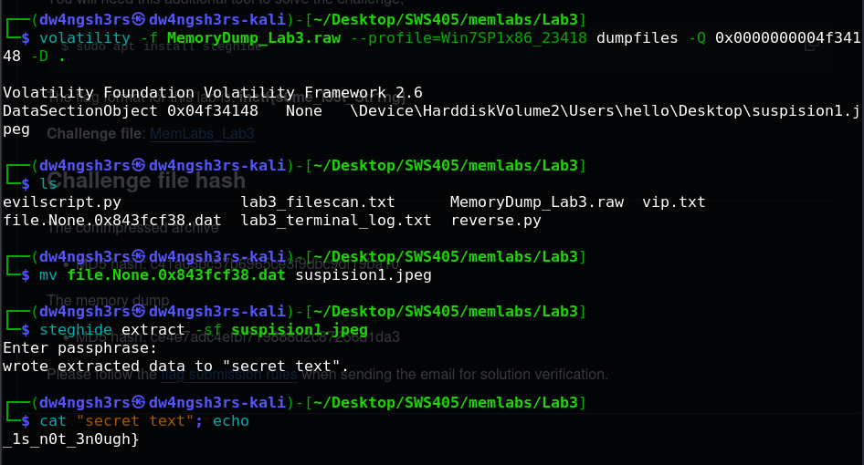

*Figure 3.9 – steghide extraction using the first half as passphrase reveals the second half: `_1s_n0t_3n0ugh}`.*

### 7.2 Flag

| Part | Value | Evidence |
|---|---|---|
| First half | `inctf{0n3_h4lf` | Figure 3.7 |
| Second half | `_1s_n0t_3n0ugh}` | Figure 3.9 |
| **Complete flag** | **`inctf{0n3_h4lf_1s_n0t_3n0ugh}`** | Figures 3.7 + 3.9 |

### 7.3 Transformation and How I Reversed It

The script applied two steps: **(1) XOR each character with 3**, then **(2) Base64-encode**. I reversed them in the opposite order, like taking off shoes before socks: **Base64-decode first, then XOR with 3**. I did not need to brute-force the key because the script itself, recovered from memory, contained the key. This is stronger evidence than guessing, since the attacker's own tool explains exactly how to undo the damage.

### 7.4 Forensic Reasoning

`cmdline` was the key step because it linked each running Notepad to the exact file it had open, which led me straight to both the attacker's tool and its output. `filescan` and `dumpfiles` recovered both files from the Windows file cache in RAM. Searching only for formats steghide supports narrowed hundreds of files down to one suspicious image. The lab shows that memory can preserve **both the encrypted data and the tool that encrypted it**, which makes the encryption reversible.

---

## 8. Lab 4 — Obsession

**Scenario:** The system was compromised, and the hacker deleted a very important file. The only evidence is the memory dump. There is one flag, in format `inctf{...}`.

### 8.1 Investigation Log

**Step 1 — Verify and identify the image**
```bash
md5sum MemoryDump_Lab4.raw
volatility -f MemoryDump_Lab4.raw imageinfo
```

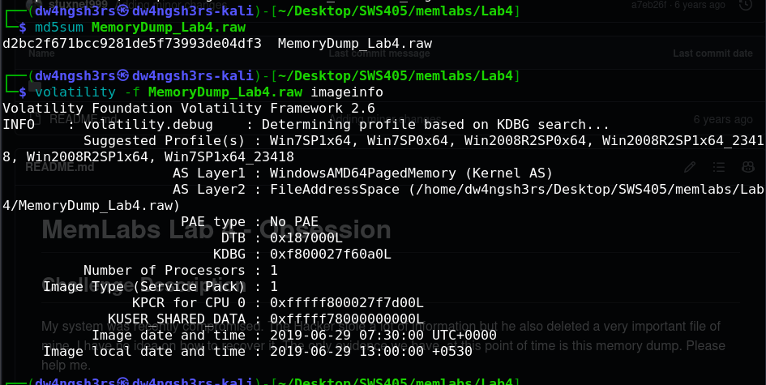

*Figure 4.1 – MD5 matches; profile Win7SP1x64.*

**Step 2 — List files on the Desktop**
```bash
volatility -f MemoryDump_Lab4.raw --profile=Win7SP1x64 filescan > lab4_filescan.txt
grep -i "\\\\Desktop\\\\" lab4_filescan.txt
```
There were two user accounts with Desktop files, `eminem` and `SlimShady`. Two files stood out:
- `\Users\eminem\Desktop\galf.jpeg`: a suspicious image ("galf" is "flag" backwards)
- `\Users\SlimShady\Desktop\Important.txt`: an important-looking text file

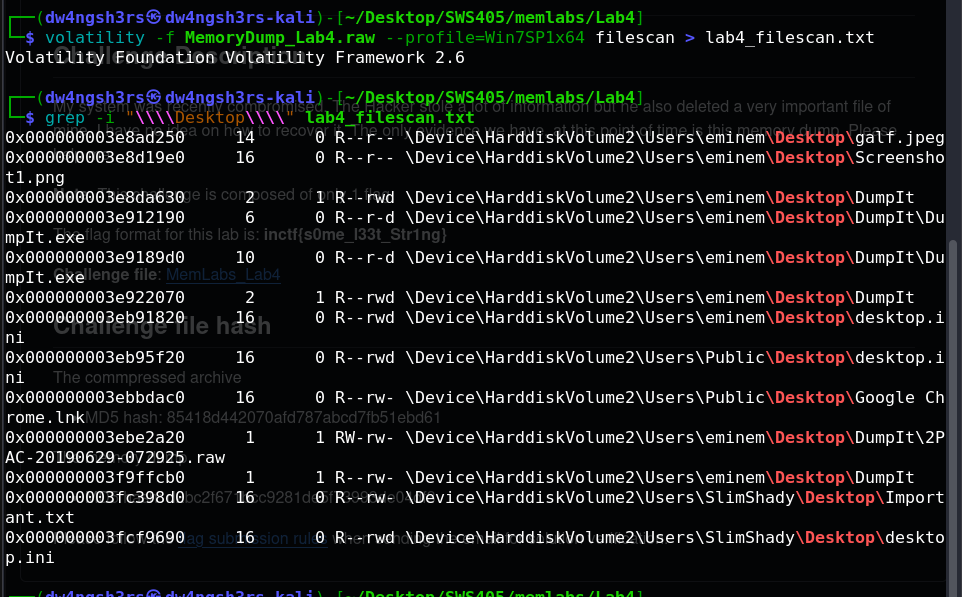

*Figure 4.2 – Desktop files, including galf.jpeg and Important.txt.*

**Step 3 — Steganography check on the image (dead end)**

As the brief instructed, I checked the image first while expecting it to be a distraction.
```bash
volatility -f MemoryDump_Lab4.raw --profile=Win7SP1x64 dumpfiles -Q 0x000000003e8ad250 -D .
mv file.None.0xfffffa80022ad0f0.dat galf.jpeg
file galf.jpeg
exiftool galf.jpeg | head -20
strings galf.jpeg | grep -i "inctf"
binwalk galf.jpeg
steghide info galf.jpeg
```
Results:
- `file`/`exiftool`: a normal 1500×844 JPEG with no useful metadata.
- `strings`: no `inctf` string.
- `binwalk`: only JPEG data; nothing appended.
- `steghide info`: with an empty passphrase, it reported an embedded file named **`LMAO.txt`** (38 bytes, AES-128 encrypted).

The reversed "flag" filename and a hidden file called "LMAO" point to a deliberate **decoy** meant to waste time. None of these checks produced an `inctf{...}` flag, so I recorded the result and moved on to the text file. Documenting a dead end matters because it shows which evidence was examined and why it was ruled out, so another investigator does not have to repeat the work.

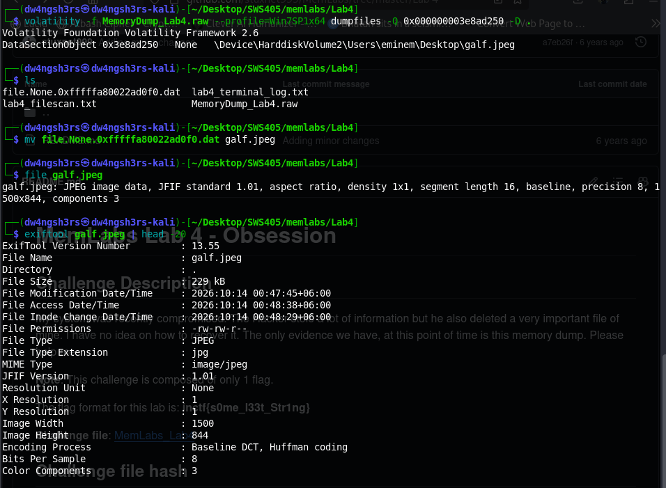

*Figure 4.3 – galf.jpeg extracted; file and exiftool show a normal JPEG.*

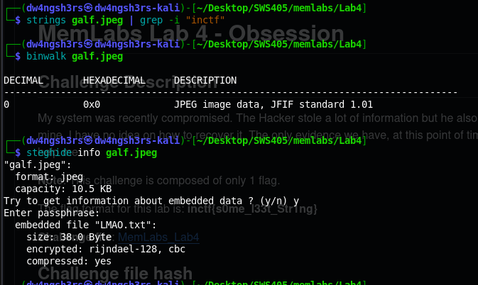

*Figure 4.4 – strings, binwalk and steghide: no flag; only a decoy "LMAO.txt". Dead end.*

**Step 4 — Normal extraction of Important.txt fails**
```bash
volatility -f MemoryDump_Lab4.raw --profile=Win7SP1x64 dumpfiles -Q 0x000000003fc398d0 -D .
ls -l
```
Volatility found the file object (it printed a `DataSectionObject` line), but **no file was written**. The directory listing shows no new `file.None...` output.

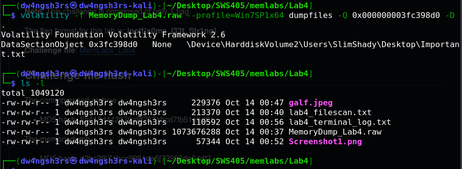

*Figure 4.5 – dumpfiles on Important.txt: the object is listed, but no content is extracted.*

**Step 5 — Recover the file from the MFT**
```bash
volatility -f MemoryDump_Lab4.raw --profile=Win7SP1x64 mftparser > lab4_mft.txt
wc -l lab4_mft.txt
grep -n -A 20 -i "Important.txt" lab4_mft.txt
```
`mftparser` produced 173,544 lines. The record for `Users\SlimShady\Desktop\Important.txt` (created 2019-06-27 13:14:13 UTC) contained a **`$DATA`** attribute with the file's content stored as hex inside the MFT record. The text was split up by many `0d 0a` (line break) bytes.

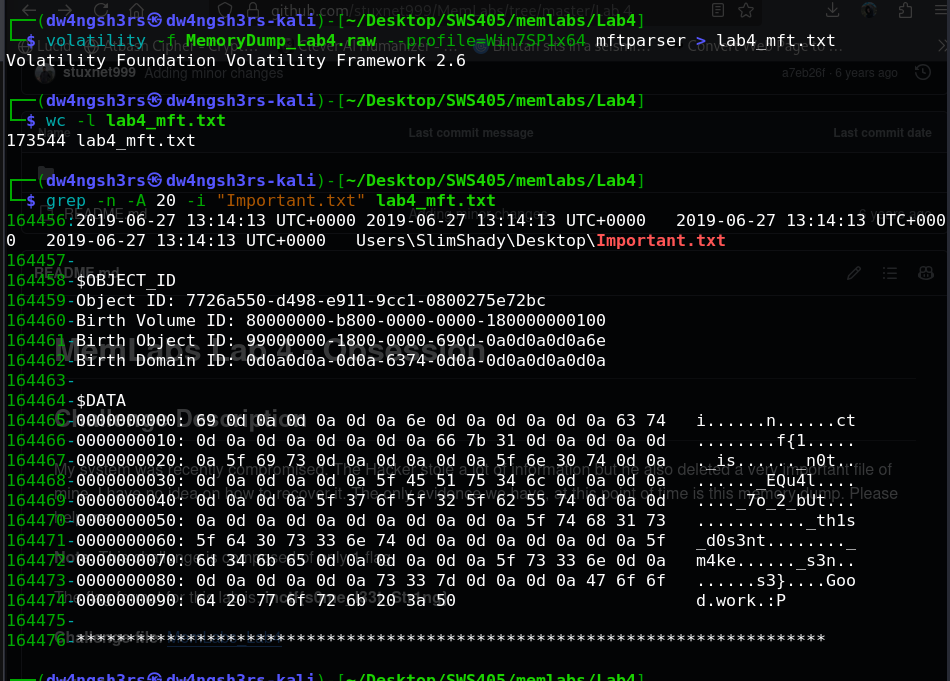

*Figure 4.6 – MFT record for Important.txt with its resident `$DATA` content (MFT-based recovery).*

I converted the hex back into bytes and removed the line breaks:
```bash
grep -A 20 -i "Important.txt" lab4_mft.txt | grep -E "^[0-9a-f]{10}:" | cut -c13-60 | xxd -r -p | tr -d '\r\n'; echo
```

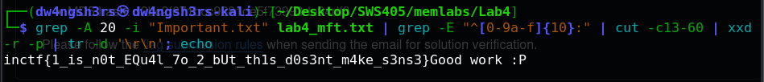

*Figure 4.7 – **Flag:** `inctf{1_is_n0t_EQu4l_7o_2_bUt_th1s_d0s3nt_m4ke_s3ns3}` (followed by "Good work :P").*

### 8.2 Flag

| Flag | Evidence |
|---|---|
| `inctf{1_is_n0t_EQu4l_7o_2_bUt_th1s_d0s3nt_m4ke_s3ns3}` | Figures 4.6, 4.7 |

### 8.3 Why dumpfiles Failed but MFT Parsing Succeeded

`dumpfiles` rebuilds a file from the **cached data pages** that Windows keeps in memory for an open or recently used file. When the file was deleted, those cached pages were freed. Volatility could still find the file object and its name (which is why Important.txt appeared in `filescan`), but there was no content behind it to write out. NTFS, however, keeps a **Master File Table (MFT)** record for every file, and for **very small files the content is stored directly inside the MFT record** as a "resident" `$DATA` attribute. That MFT record was still cached in RAM, so `mftparser` could read the file's content from it even though the file itself was gone. This lab shows that **deleting a file does not immediately destroy its evidence**: metadata structures like the MFT can keep the data long after the normal file object is empty.

Analogy: deleting the file removed the book from the shelf, so `dumpfiles` found an empty shelf. The library's catalogue card (the MFT record) was still there, and because the note was tiny, the whole text was written on the card.

---

## 9. Lab 5 — Black Tuesday

**Scenario:** Someone accessed the client's system while he was away, and strange files with unreadable names made of letters and numbers were accessed. His favourite application also crashed every time he ran it. The brief requires two flags; the first unlocks the second.

### 9.1 Investigation Log

**Step 1 — Verify and identify the image**
```bash
md5sum MemoryDump_Lab5.raw
volatility -f MemoryDump_Lab5.raw imageinfo
```

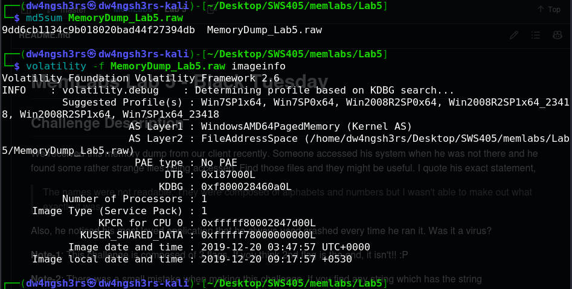

*Figure 5.1 – MD5 matches; profile Win7SP1x64.*

**Step 2 — Scope the processes**
```bash
volatility -f MemoryDump_Lab5.raw --profile=Win7SP1x64 pslist
```
Notable processes: `WinRAR.exe` (2924, the archive manager), `notepad.exe` (2744), `DumpIt.exe` (2208, acquisition tool), and three `NOTEPAD.EXE` processes (2724, 1388, 2056), each followed by a `WerFault.exe` (2716, 780, 2168). WerFault is the Windows crash reporter, which matches the "application crashed every time" clue.

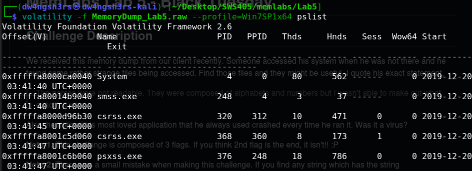

*Figure 5.2 – pslist (part 1).*


*Figure 5.3 – pslist (part 2): WinRAR.exe, DumpIt.exe, and NOTEPAD.EXE processes each followed by WerFault.exe.*

**Step 3 — Extract the archive WinRAR had open**
```bash
volatility -f MemoryDump_Lab5.raw --profile=Win7SP1x64 cmdline -p 2924
echo 'SW1wb3J0YW50' | base64 -d; echo
```
WinRAR had opened `C:\Users\SmartNet\Documents\SW1wb3J0YW50.rar`. The filename is itself Base64 and decodes to **"Important"**, the first example of the "unreadable names" the client described.


*Figure 5.4 – WinRAR command line; the archive name decodes to "Important".*

```bash
volatility -f MemoryDump_Lab5.raw --profile=Win7SP1x64 filescan > lab5_filescan.txt
grep -i "\.rar" lab5_filescan.txt
volatility -f MemoryDump_Lab5.raw --profile=Win7SP1x64 dumpfiles -Q 0x000000003eed56f0 -D .
mv file.None.0xfffffa80010b44f0.dat Important.rar
unrar l Important.rar
```
The archive contains `Stage2.png`. The `*` in the listing means the file is **encrypted**. As the brief instructed, I did not brute-force the password and looked for it elsewhere.


*Figure 5.5 – Archive extracted from memory; Stage2.png is encrypted (`*`).*

**Step 4 — Browser history (Flag 1)**

Nothing in the process list explained the password, so I widened the search to browser history. This system used Internet Explorer / Windows Explorer rather than Chrome, so I used Volatility's built-in `iehistory` plugin.
```bash
volatility -f MemoryDump_Lab5.raw --profile=Win7SP1x64 iehistory > lab5_iehistory.txt
wc -l lab5_iehistory.txt
grep -i "URL" lab5_iehistory.txt | grep -Ei "\.(bmp|jpg|png|rar|txt|exe)"
```
One visited file had a very long, encoded name:
`file:///C:/Windows/AppPatch/ZmxhZ3shIV93M0xMX2QwbjNfU3Q0ZzMtMV8wZl9MNEJfNV9EMG4zXyEhfQ.bmp`


*Figure 5.6 – iehistory reveals a .bmp file with a long Base64-encoded name in C:\Windows\AppPatch.*

```bash
echo 'ZmxhZ3shIV93M0xMX2QwbjNfU3Q0ZzMtMV8wZl9MNEJfNV9EMG4zXyEhfQ' | base64 -d; echo
```
The decoded flag already read `L4B_5_D0n3`, so the README's Note-2 correction (`L4B_3_D0n3` → `L4B_5_D0n3`) was not needed.


*Figure 5.7 – **Flag 1:** `flag{!!_w3LL_d0n3_St4g3-1_0f_L4B_5_D0n3_!!}`.*

**Step 5 — Open the archive (Flag 2)**
```bash
unrar x Important.rar    # password: flag{!!_w3LL_d0n3_St4g3-1_0f_L4B_5_D0n3_!!}
```


*Figure 5.8 – Flag 1 used as the password; Stage2.png extracted ("All OK").*


*Figure 5.9 – **Flag 2:** `flag{W1th_th1s_$taGe_2_1s_cOmPL3T3_!!}`.*

**Step 6 — Extra: the crashing application (not required by the brief)**

The README mentions a third flag and asks whether the crashing application was a virus, so I also investigated the crashes.
```bash
volatility -f MemoryDump_Lab5.raw --profile=Win7SP1x64 cmdline | grep -iE -A1 "notepad|WerFault"
grep -i "notepad.exe" lab5_filescan.txt
```
The real Notepad (2744) ran from `C:\Windows\system32\`, but `NOTEPAD.EXE` (2724) ran from **`C:\Users\SmartNet\Videos\NOTEPAD.EXE`**, an unusual location for a system program. `WerFault.exe -u -p 2724` shows the crash reporter was triggered by exactly that process. The same pattern repeated for PIDs 1388 and 2056. This is a fake Notepad masquerading as the real one.


*Figure 5.10 – NOTEPAD.EXE runs from the Videos folder, and WerFault reports its crash (`-p 2724`).*

```bash
volatility -f MemoryDump_Lab5.raw --profile=Win7SP1x64 dumpfiles -Q 0x000000003ee9d070 -D .
objdump -d -M intel file.None.0xfffffa80021a1600.img | grep -oE "mov +e[a-d]x,0x[0-9a-f]{2}$" | awk -F'0x' '{print $2}' | xxd -r -p | tr -cd '[:print:]'; echo
```
The flag is built one character at a time with `mov` instructions, so `strings` cannot see it. Extracting the single-byte values from the disassembly gave `ubi0s{M3m_l4B5_OVeR_!}`. The leading `u` comes from an unrelated instruction just before the flag-building code, so the flag starts at `bi0s{`.


*Figure 5.11 – Extra flag recovered from the fake NOTEPAD.EXE disassembly: `bi0s{M3m_l4B5_OVeR_!}`.*

### 9.2 Flags

| # | Flag | Evidence |
|---|---|---|
| 1 | `flag{!!_w3LL_d0n3_St4g3-1_0f_L4B_5_D0n3_!!}` | Figures 5.6, 5.7 |
| 2 | `flag{W1th_th1s_$taGe_2_1s_cOmPL3T3_!!}` | Figures 5.8, 5.9 |
| Extra | `bi0s{M3m_l4B5_OVeR_!}` | Figures 5.10, 5.11 |

### 9.3 Browser-History Plugin Choice

I used the built-in **`iehistory`** plugin because this system's history was stored by Internet Explorer / Windows Explorer in WinINet `index.dat` cache records (including `file:///` visits), which is exactly what `iehistory` parses. The community `chromehistory` plugin from Lab 2 only reads Chrome's SQLite `History` database, so it would find nothing here.

### 9.4 Forensic Reasoning

`cmdline` and `filescan`/`dumpfiles` recovered the locked archive, but its key was not in any process. It was only recorded in the browser's history cache, which logs local file access as well as websites. This shows why an investigator must **widen the search** when the obvious artifacts run out. The fake NOTEPAD.EXE also shows the value of checking **where** a process runs from, not just its name: a system program outside `System32` is a strong indicator of masquerading.

---

## 10. Conclusion

All required flags for Labs 1–5 were recovered, along with one extra flag in Lab 5. The labs showed that RAM keeps evidence that never reaches the disk or that has been deleted from it:

- **Volatile data:** terminal output (`consoles`) and an unsaved drawing (`memdump`) existed only in memory.
- **Credentials:** account hashes (`hashdump`) and a password manager's key were recoverable from memory.
- **Deleted data:** a deleted file's content survived in its MFT record (`mftparser`), and a deleted KeePass entry survived in its Recycle Bin.
- **Correlation:** single artifacts rarely solved a lab. Each flag came from linking a process → its command line → a file → a credential or history record.

I also learned to work around tool problems. When the `volatility` apt package was unavailable I used the standalone binary, and when `chromehistory` failed I queried Chrome's SQLite database directly. Recording dead ends (the GIMP noise, the failed plugin, the Lab 4 decoy image) made the investigation repeatable and the conclusions easier to trust.

---

## 11. Appendix — Evidence Files

Each lab folder contains the files extracted during the investigation and the terminal log recorded with `script`:

| Folder | Key files |
|---|---|
| `Lab1/` | `2424.data` (mspaint memory ziped), `Important.rar`, `flag3.png`, `lab1_filescan.txt`, `lab1_terminal_log.zip` |
| `Lab2/` | `Hidden.kdbx`, `Password.png`, `History`, `lab2_envars.txt`, `lab2_filescan.txt`, `lab2_chromehistory.txt`, `lab2_terminal_log.txt` |
| `Lab3/` | `evilscript.py`, `vip.txt`, `reverse.py`, `suspision1.jpeg`, `secret text`, `lab3_filescan.txt`, `lab3_terminal_log.txt` |
| `Lab4/` | `galf.jpeg`, `Screenshot1.png`, `lab4_filescan.txt`, `lab4_mft.txt`, `lab4_terminal_log.txt` |
| `Lab5/` | `Important.rar`, `Stage2.png`, `file.None.0xfffffa80021a1600.img` (fake NOTEPAD.EXE), `lab5_filescan.txt`, `lab5_iehistory.txt`, `lab5_terminal_log.txt` |
| `Screenshots/` | All labeled evidence screenshots, organised by lab |